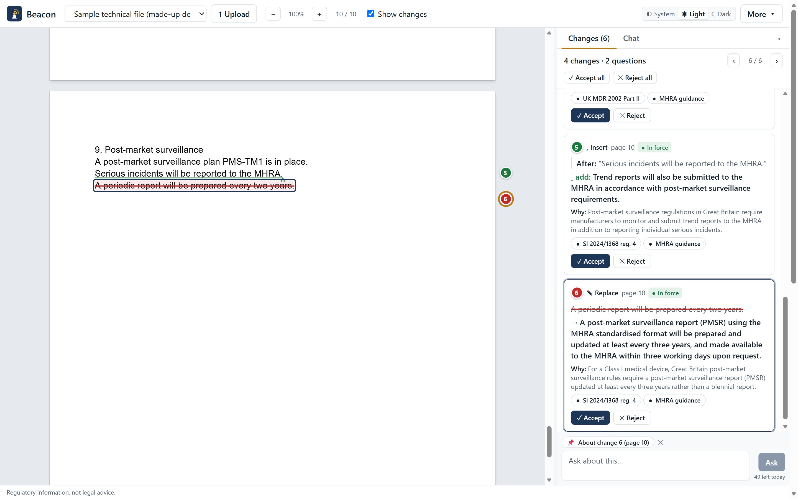
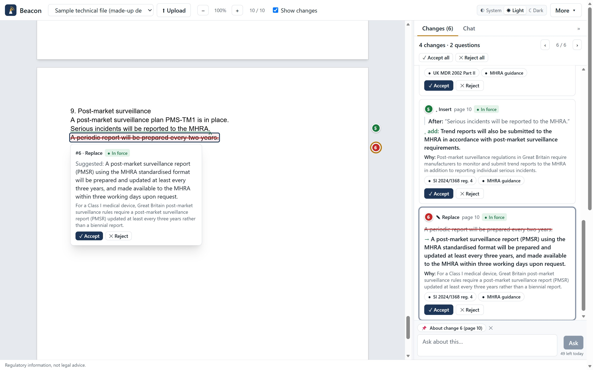
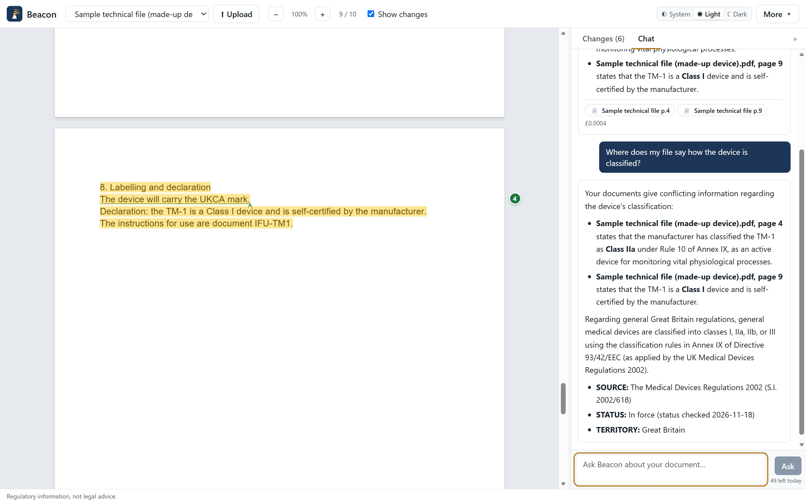
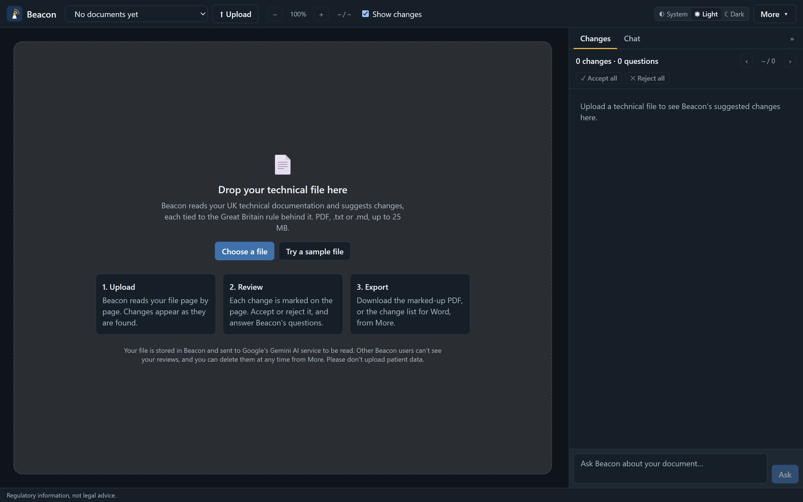
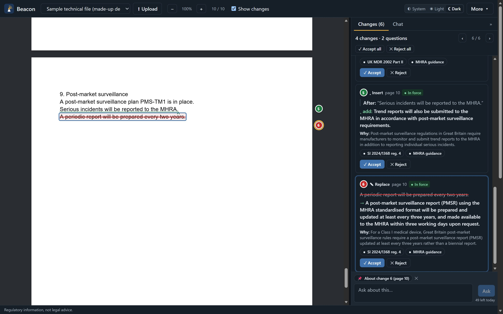
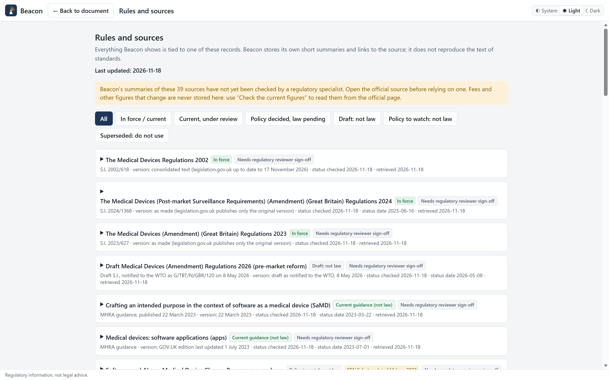
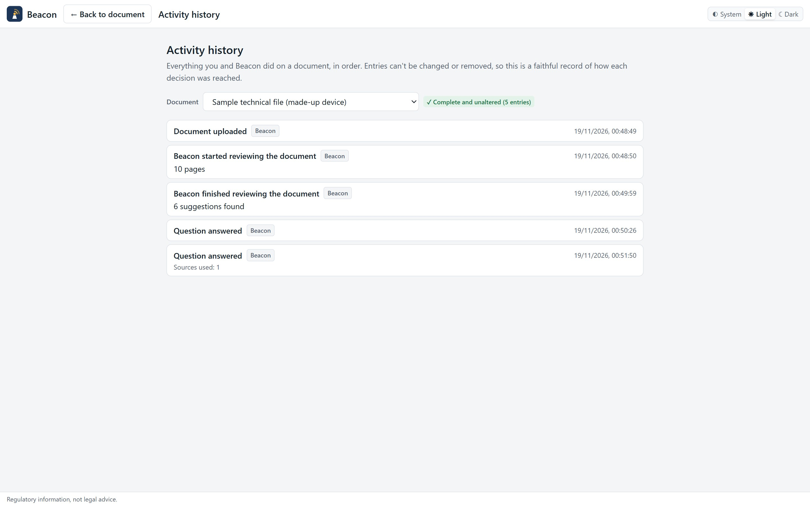

<h1 align="center">Beacon</h1>

<strong>Your UK medical-device technical file, reviewed like a document should be.</strong>

  <a href="https://github.com/mz-846/beacon-download/releases/latest/download/Beacon-Setup.exe"><strong>⬇ Download for Windows</strong></a>
  &nbsp;·&nbsp;
  <a href="https://mz-846.github.io/beacon-download/">Website</a>
  &nbsp;·&nbsp;
  <a href="https://github.com/mz-846/beacon-download/releases">All versions</a>

Upload your technical documentation. Beacon marks it up with suggested changes, page by page. Each change is tied to the Great Britain rule behind it, and you decide what to keep.

Screenshots show Beacon reviewing a made-up sample file. They are examples, not advice about any real device.

## How it works

**1. Drop in your technical file.** Drag in a PDF, or click **Try a sample file** to see a review first. Changes appear as Beacon finds them.

**2. See every change on the page.** Words to replace are struck through, a caret ^ shows where to add something, and questions get a bubble in the margin. Hover over a mark to accept or reject it.

**3. Decide, one change at a time.** Each suggestion shows the current text, the new text, why, and the regulation behind it. Where the answer depends on facts only you know, Beacon asks a question instead of guessing.

**4. Ask about anything.** Answers cite the pages of your file and the regulations they rely on. Click a page and the passage lights up.

**5. Take your work with you.** Export the PDF with Beacon's changes as standard comments, or the change list as a Word document.

## You can always see where a suggestion comes from

Every suggestion names its source and provision, and is labelled with one of four words, never by colour alone:

| Label | Meaning |
|---|---|
| **In force** | Law that applies today. |
| **Pending** | Made, or decided as policy, but not applying yet. |
| **Draft** | A draft or proposal that could still change. |
| **Question** | Something only you can answer. |

If Beacon can't find the exact words on the page, it says "location not found" rather than marking the wrong place. Every suggestion and decision is kept in an activity history that can't be altered.

<table>
<tr>
<td></td>
<td></td>
</tr>
<tr>
<td></td>
<td></td>
</tr>
</table>

## Try Beacon

Beacon is in a free, **invitation-only** trial for Windows 10 and 11. You'll need an invitation to sign in.

1. [Download **Beacon-Setup.exe**](https://github.com/mz-846/beacon-download/releases/latest/download/Beacon-Setup.exe) and open it.
2. If Windows says *"Windows protected your PC"*, click **More info**, then **Run anyway**. This appears because Beacon is new and not yet code-signed.
3. Open **Beacon** from the Start menu, click **Sign in**, and use the email address you were invited with. If your browser shows "You are about to visit…", click **Visit Site**.

**Good to know:** your documents are sent to Google's Gemini AI service to be read. Other users can't see them, and you can delete them at any time. Please don't upload patient data. Beacon covers Great Britain only; Northern Ireland is flagged, not assessed.

---

Beacon gives regulatory information to help you see what needs reviewing. It is not legal, regulatory or clinical advice, it does not decide whether your device complies, and it does not make submissions for you. This repository holds the Windows installer and screenshots only. © 2026 Beacon. All rights reserved.
